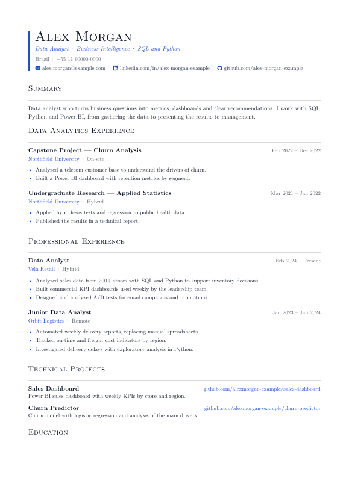
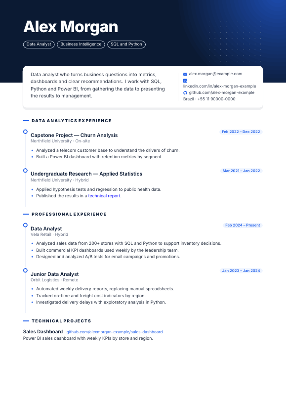
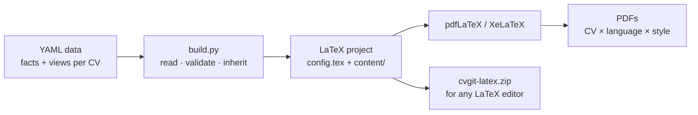

# 🚀 CVGit — Résumé Generator: YAML to LaTeX, Tailored per Job

**CVGit** turns a résumé into data. Experience, projects and skills are written once in YAML; a
Python build validates them, applies the inheritance rules and generates a LaTeX project, compiled
into tailored CVs for each kind of job and for each opening, in Portuguese and English, in an
ATS-friendly style and a designed one. One fact, many views, every PDF reproducible with Docker.

**Author:** Kevin Mota da Costa

**Portfolio:** https://costakevinn.github.io

**LinkedIn:** https://linkedin.com/in/costakevinnn

---

## 📊 Results

| `ats`: for online applications | `fancy`: for people |
|---|---|
|  |  |

- **One data folder, every CV:** each CV × 2 languages × 2 styles. The example (4 CVs) builds 16 PDFs; my own data (3 base CVs and 2 job CVs) builds 20.
- **Tailored per opening in minutes:** a job CV holds only what changes (a title, a summary, the order of the projects) and inherits the rest.
- **ATS-safe output:** single-column layout, standard section titles, no hyphenated keywords and clean text extraction, checked on the generated PDFs.
- **Mistakes caught before LaTeX:** every error names the file and what is wrong.

The CVs above are the example in [`example/`](example/): Alex Morgan, a fictional data analyst.

---

## 💡 What This Project Demonstrates

- **Data modeling:** facts (dates, companies, links) are stored once; each CV holds only its own view of them (titles, bullets, descriptions, order)
- **Inheritance rules:** job CVs override a base by file, by item (empty file = as the base; partial file = only those fields) and by line (skills: replace, remove, add)
- **Validation:** schema checks with actionable messages, so a typo never reaches a recruiter
- **Code generation:** YAML compiled into LaTeX macros; styles are pluggable folders that draw them
- **Document engineering:** LaTeX with pdfLaTeX and XeLaTeX, layout rules for page breaks, text extraction tested for applicant tracking systems
- **Reproducibility:** Docker, pinned dependencies, one command for every PDF, unit tests

---

## 🧠 How It Works



1. **Read and validate:** every YAML file is checked (required fields, dates, number of bullets, links).
2. **Inherit:** each job CV is merged with its base, field by field and item by item.
3. **Generate:** the data becomes LaTeX macros, one file per CV and language, inside a LaTeX project whose `config.tex` chooses the CV, language and style.
4. **Compile:** every combination is compiled; the same project also works in any LaTeX editor.

---

## 📐 Design Choices

| Choice | Why |
|---|---|
| Facts separate from views | A date or a company is written once; each CV says it in its own words |
| Base CVs and job CVs | One base per kind of job; a job CV changes only what the opening asks for |
| Order in the file name (`01-`, `02-`) | The order is visible in the folder, and an item appears only where it has a file |
| Empty file = "as the base" | Reordering a job CV never means copying text |
| Fixed set of styles over one data model | A new look never touches the data; the ATS style stays plain on purpose |
| Errors name the file | A typo is fixed in seconds, not found later in a PDF |
| Docker for LaTeX | The same PDFs on any machine, with no local TeX installation |

---

## 🗂 Structure

```
CVGit/
├── scripts/build.py      # YAML -> validation -> inheritance -> LaTeX -> PDFs
├── latex/
│   ├── main.tex          # the document, the same for every CV
│   └── styles/           # ats/ and fancy/: header, sections and layout
├── example/              # a complete fictional profile: start here
├── data/                 # your data (ignored by Git)
├── tests/                # unit tests (YAML only, no LaTeX)
├── docs/                 # technical documentation and images
├── Dockerfile · docker-compose.yml
└── run.sh · build_run.sh
```

---

## 🛠 Tech Stack

**Programming:** Python, PyYAML

**Documents:** LaTeX (pdfLaTeX, XeLaTeX), TikZ

**Engineering:** Docker / Docker Compose, unittest, Git / GitHub, Linux

---

## ▶ Usage

Requires [Docker](https://docs.docker.com/get-docker/).

```bash
git clone https://github.com/costakevinn/CVGit.git
cd CVGit
./build_run.sh            # builds the image (first time), then every CV of the example
```

The PDFs are in `dist/example/`, e.g. `analytics-en-ats.pdf`. To use your own data:

```bash
cp -r example data        # edit the YAML files in data/
./run.sh                  # every CV
./run.sh <cv> [pt|en]     # one CV
./run.sh test             # the tests
```

`data/` is ignored by Git: keep your real data in a private copy. The full guide (every file, the
inheritance rules, the LaTeX project and how to write a style) is in the documentation.

---

## 📄 Documentation

Technical documentation (data model, inheritance, validation, build pipeline, styles, tests): [`docs/CVGit_documentation.pdf`](docs/CVGit_documentation.pdf)

---

## 🌐 Portfolio

This project is part of my Machine Learning & Data Engineering portfolio:
👉 https://costakevinn.github.io

---

## License

MIT License — see `LICENSE` for details.
